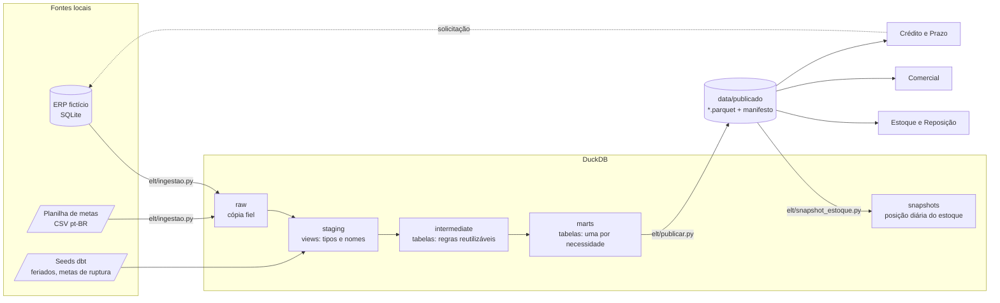

# Portfólio · ELT e painéis de uma distribuidora

Demonstração de engenharia e análise de dados para a **Distribuidora Andorinha**, uma distribuidora de bebidas **fictícia** com quatro unidades: um centro de distribuição e três filiais. Empresa, marcas, fabricantes, clientes, números e regras de negócio foram inventados. Os dados são **sintéticos**, gerados por código com semente fixa.

O projeto percorre o caminho inteiro do dado, numa só máquina e sem serviço externo:

```
fontes locais ──(Python)──▶ raw ──(dbt: staging ▶ intermediate ▶ marts)──▶ Parquet ──▶ 3 painéis Dash
```

| Painel | O que mostra |
|---|---|
| **Estoque e Reposição** | Saldo, cobertura em dias úteis, produtos em trânsito entre unidades, quanto puxar ou reduzir por produto e revenda, e um snapshot diário. |
| **Comercial** | Diário de vendas com tendência e meta, metas por vendedor, carteira de clientes com filtros cruzados, ruptura de cobertura e o painel de um fabricante parceiro. |
| **Crédito e Prazo** | Consulta de limite e prazo, cobrança, solicitações, histórico das implantações e pedidos do cliente. A solicitação de alteração grava só no ambiente local. |

## Sumário

- [O que o projeto demonstra](#o-que-o-projeto-demonstra)
- [Pré-requisitos](#pré-requisitos)
- [Instalação](#instalação)
- [Execução](#execução)
  - [1. Gerar os dados e rodar o ELT](#1-gerar-os-dados-e-rodar-o-elt)
  - [2. Abrir os painéis](#2-abrir-os-painéis) · [acesso pela rede](#acesso-pela-rede)
  - [3. Rodar os testes](#3-rodar-os-testes)
  - [Outras opções do ELT](#outras-opções-do-elt)
- [Publicação online (Posit Connect Cloud)](#publicação-online-posit-connect-cloud)
- [Arquitetura](#arquitetura)
  - [Por que DuckDB](#por-que-duckdb)
  - [Por que Parquet entre o banco e os painéis](#por-que-parquet-entre-o-banco-e-os-painéis)
  - [Camadas](#camadas)
- [Das fontes a cada painel](#das-fontes-a-cada-painel)
- [Regras fictícias e onde vê-las na tela](#regras-fictícias-e-onde-vê-las-na-tela)
- [Ações que gravam dados](#ações-que-gravam-dados-só-no-ambiente-local)
- [Reexecução e idempotência](#reexecução-e-idempotência)
- [Estrutura](#estrutura)
- [Limites conhecidos](#limites-conhecidos)

## O que o projeto demonstra

- **ELT em camadas, com papéis separados.** A ingestão em Python só copia as fontes para `raw`, sem regra de negócio. Toda regra fica no dbt: `staging` limpa e tipa, `intermediate` aplica as regras reutilizáveis, `marts` entrega uma tabela por necessidade de tela. Cada mart tem o grão documentado.
- **Carga idempotente.** Tabelas pequenas são substituídas inteiras numa transação. Pedidos e itens usam **carga por janela**: apagam e recarregam só os últimos meses. Reexecutar não duplica registros, e um teste prova isso.
- **Reprodutibilidade.** Semente e "data de hoje" são fixas (`elt/config.py`). Duas execuções com a mesma entrada publicam arquivos de conteúdo idêntico, e o manifesto guarda um hash de cada Parquet para comparar.
- **Qualidade como parte do pipeline.** São 54 testes dbt: grão único, `not_null`, relacionamentos, valores aceitos e regras de negócio por domínio. Eles rodam dentro do `dbt build`, e um teste reprovado interrompe a publicação. O pytest cobre o gerador, a carga, a reexecução completa e os painéis pelo HTTP do Dash.
- **Publicação desacoplada.** Os painéis leem **só Parquet**, sem abrir o banco. O Parquet é gravado num arquivo temporário e trocado de uma vez, para o painel nunca ler um arquivo pela metade; resultado vazio não substitui o anterior.
- **Regras parametrizadas.** Faixas de estoque, critérios de crédito, escada de limites, juros e tolerâncias ficam em `vars` do `transform/dbt_project.yml`, num lugar só.
- **Painéis sem regra duplicada.** O painel filtra e soma. A conta de negócio (mínimo, máximo, reposição, limite sugerido, ruptura) vem pronta do mart. O que não é aditivo, como clientes distintos, é contado depois dos filtros, a partir de um mart por cliente.
- **Escrita segura e local.** A implantação mensal de limite e prazo simula por padrão, roda em transação, tem trava contra repetição e desfaz a revenda inteira se uma linha falhar.

## Pré-requisitos

- Python **3.12** (testado em Windows 11; os comandos `python -m` funcionam igual em Linux e macOS).
- Cerca de 300 MB livres para o ambiente virtual e os dados gerados.
- Não precisa de banco instalado, de credencial nem de internet depois da instalação.

## Instalação

```powershell
py -3.12 -m venv .venv
.venv\Scripts\python.exe -m pip install -r requirements-dev.txt
```

Em Linux ou macOS: `python3.12 -m venv .venv && .venv/bin/pip install -r requirements-dev.txt`.

`requirements-dev.txt` instala o projeto inteiro: o `requirements.txt` (só os painéis, o que a [publicação online](#publicação-online-posit-connect-cloud) instala) mais o pipeline (DuckDB, dbt) e o pytest.

## Execução

### 1. Gerar os dados e rodar o ELT

O ELT completo leva cerca de 1 minuto:

```powershell
elt.bat                      # ou: .venv\Scripts\python.exe -m elt
```

O comando faz, em ordem:

1. gera as fontes em `data/fontes/`;
2. carrega a camada `raw`;
3. roda `dbt build` (seeds, modelos e testes);
4. publica os Parquet em `data/publicado/`;
5. grava o snapshot do estoque.

### 2. Abrir os painéis

```powershell
paineis.bat                  # ou: .venv\Scripts\python.exe -m paineis --abrir
```

Os painéis ficam em <http://127.0.0.1:8050/>, com a página inicial e os três painéis em `/estoque/`, `/comercial/` e `/credito/`. `Ctrl+C` encerra.

#### Acesso pela rede

O servidor (waitress) escuta em `0.0.0.0`, então outras pessoas na mesma rede abrem os painéis pelo IP desta máquina. Ao subir, ele mostra o link certo (`na rede: http://192.168.x.y:8050/`). Para deixar só nesta máquina: `paineis.bat --host 127.0.0.1`.

Se ninguém mais consegue abrir o link:

- na primeira execução, o Windows pergunta se o Python pode receber conexões: permita em **redes privadas**;
- a rede do notebook precisa estar como **Privada** (Configurações › Rede e Internet › propriedades da conexão), porque em rede Pública o firewall bloqueia;
- se a pergunta foi recusada, libere a porta num PowerShell como administrador: `netsh advfirewall firewall add rule name="Paineis 8050" dir=in action=allow protocol=TCP localport=8050 profile=private`.

### 3. Rodar os testes

```powershell
.venv\Scripts\python.exe -m pytest                # tudo (cerca de 4 minutos; inclui 3 execuções completas do ELT)
.venv\Scripts\python.exe -m pytest -m "not lento" # sem a reexecução completa (cerca de 1 minuto)
```

Os testes dos painéis leem o que o último `elt` publicou. Os testes do pipeline rodam em pastas temporárias e não tocam em `data/`.

### Outras opções do ELT

| Comando | Efeito |
|---|---|
| `python -m elt --manter-fontes` | Não regenera as fontes; preserva o que os painéis gravaram nelas. Pedidos e itens entram pela carga por janela. |
| `python -m elt --manter-fontes --completo` | Igual ao anterior, recarregando o histórico inteiro. |
| `python -m elt.gerar_fontes` | Só gera as fontes. |
| `python -m elt.credito_implantacao [--executar]` | Implantação mensal de limite e prazo no ERP local; sem `--executar`, só simula. |

## Publicação online (Posit Connect Cloud)

Os painéis podem ser publicados direto do GitHub no [Posit Connect Cloud](https://connect.posit.cloud/). No plano gratuito, o repositório precisa ser público. A hospedagem só serve os painéis e não roda o ELT. Por isso `data/publicado/` e `data/snapshots/` (cerca de 1 MB) são versionados. Como o pipeline é determinístico, rodar o ELT de novo gera os mesmos bytes, e o git só acusa mudança quando o pipeline muda de fato.

No formulário de publicação (**Publish › GitHub**):

| Campo | Valor |
|---|---|
| Framework | **Dash** |
| Repositório e branch | este repositório, `main` |
| Primary file | `app.py` |
| Advanced settings › Python version | **3.12**. O padrão é 3.11, e o `numpy` 2.5 exige 3.12. |

- `app.py` expõe `app`, um objeto Dash. O servidor Flask desse objeto atende a página inicial e os três painéis.
- `requirements.txt` tem só as dependências dos painéis, que é o que a hospedagem instala. O pipeline e os testes ficam em `requirements-dev.txt`.
- Cada `git push` na `main` republica sozinho. Dá para desligar isso nas configurações do conteúdo.
- Na versão online, a solicitação de crédito avisa que a publicação é só para consulta, porque o ERP local (`data/fontes/erp.sqlite`) não vai para o servidor.
- Quando mudar uma regra no pipeline, rode o ELT e faça commit de `data/publicado/` e `data/snapshots/` junto com o código.

Para testar localmente do mesmo jeito que a hospedagem carrega:

```powershell
.venv\Scripts\waitress-serve.exe --port 8050 app:app
```

## Arquitetura



### Por que DuckDB

O dbt precisa de um banco, e o DuckDB roda dentro do processo Python, num arquivo só (`data/warehouse/distribuidora.duckdb`), sem servidor nem credencial. O adaptador `dbt-duckdb` aceita o SQL analítico usado nos modelos: CTEs, `qualify`, `filter`, janelas e `generate_series`. A troca por um Postgres de produção mudaria o `profiles.yml` e poucas funções de data.

### Por que Parquet entre o banco e os painéis

O painel não precisa de conexão nem de credencial. O arquivo é pequeno, preserva os tipos e é lido por inteiro a cada interação, então a tela pega sozinha a publicação nova. O DuckDB aceita um só processo gravando, e assim o ELT pode rodar com os painéis abertos.

### Camadas

| Camada | Materialização | Papel |
|---|---|---|
| `raw` | tabela (Python) | Cópia da fonte, colunas listadas explicitamente, datas ainda em texto e coluna de auditoria `_extraido_em`. |
| `staging` (19) | view | Tipos, nomes de coluna e conversões; o número pt-BR da planilha, `'+5.000,00'`, vira `5000.0`. |
| `intermediate` (12) | tabela | Regras reutilizáveis: calendário de dias úteis, venda líquida, custo vigente, trânsito, carteira por competência, títulos em aberto, média de atraso, metas. |
| `marts` (17) | tabela | Uma tabela por necessidade de tela, com o grão documentado em `models/marts/_marts.yml`. |

## Das fontes a cada painel

| Painel / página | Parquet (mart) | Principais dependências no dbt | Fontes |
|---|---|---|---|
| Estoque · reposição | `estoque_reposicao` | `int_vendas_dia`, `int_custo_vigente`, `int_transito`, `int_ultima_compra`, `int_calendario` | pedidos, devoluções, saldos, contagens, custos, compras, transferências |
| Estoque · trânsito | `estoque_transito_notas`, `estoque_transferencias_recebidas` | `int_transito`, `int_ultima_compra` | compras, transferências |
| Estoque · sell-in | `sellin_sellout_mes` | `int_vendas_dia` | pedidos, compras |
| Estoque · snapshots | `data/snapshots/estoque_reposicao/*.parquet` | (cópia diária do mart) | — |
| Comercial · Diário | `vendas_diarias`, `positivacao_cliente_mes`, `metas_mes`, `periodo_analise` | `int_vendas_dia`, `int_metas`, `int_calendario` | pedidos, devoluções, planilha de metas, feriados |
| Comercial · Metas | `metas_mes`, `vendas_diarias`, `positivacao_cliente_mes` | `int_metas` | planilha de metas |
| Comercial · Carteira | `base_clientes` | `int_cliente_financeiro`, `int_faturamento_cliente_mes`, `int_cliente_vendedor_atual` | clientes, títulos, equipamentos cedidos |
| Comercial · Ruptura | `ruptura_vendedor_mes` | `int_carteira_mensal`, `int_faturamento_cliente_mes` | clientes, histórico de carteira, títulos |
| Comercial · Fabricante | `fabricante_mensal` | `int_vendas_dia`, `int_metas`, `ruptura_vendedor_mes` | pedidos, metas, seed de metas de ruptura |
| Crédito · Limite e prazo | `credito_clientes`, `credito_pedidos` | `int_cliente_financeiro`, `int_vendas_dia` | clientes, títulos, pedidos, condições de pagamento |
| Crédito · Cobrança | `credito_cobranca` | `int_titulos_abertos` | títulos |
| Crédito · Solicitações | `credito_solicitacoes` | `int_cliente_financeiro` | solicitações (geradas e registradas pelo painel) |
| Crédito · Histórico | `credito_historico` | — | histórico de implantações |
| Crédito · implantação (CLI) | `credito_alteracao` | `credito_clientes` | — |

Os grãos dos marts principais:

| Mart | Uma linha é… |
|---|---|
| `estoque_reposicao` | revenda × produto × período (mês atual, mês anterior, últimos 30 dias) × base de estoque (sistema, contagem) |
| `vendas_diarias` | revenda × data × vendedor do pedido × produto |
| `positivacao_cliente_mes` | revenda × mês × cliente × vendedor × canal do produto |
| `ruptura_vendedor_mes` | revenda × mês × vendedor da carteira |
| `base_clientes` | cliente, na posição da data de referência |
| `fabricante_mensal` | revenda × mês × canal (imediato, abastecimento e "todos") |
| `credito_clientes` | cliente ativo |
| `credito_cobranca` | título em aberto |

## Regras fictícias e onde vê-las na tela

Os parâmetros ficam em `transform/dbt_project.yml`. Os cenários são criados pelo gerador e marcados com `CENÁRIO` em `elt/gerar_fontes.py`. Os painéis abrem na revenda **20 · Andorinha Litoral**, onde a maior parte dos cenários aparece.

| Regra (inventada) | Cenário nos dados | Onde observar |
|---|---|---|
| Mínimo = média por dia útil × 8; máximo = × 14. Abaixo do mínimo, **puxar**; acima do máximo, **reduzir**. | Litoral com 3 produtos zerados; Vale com excesso de packs e garrafas PET. | Estoque: cards Puxada e Reduzir, coluna "Puxar / reduzir" em azul ou vermelho, card "Produtos em ruptura". |
| Nota emitida e ainda sem entrada no destino = **em trânsito**; "dias c/ trânsito" soma esse volume. | O CD transferiu cervejas para a Serra e para a Litoral um e dois dias antes da referência. | Estoque: coluna "Em trânsito"; o clique abre as notas (Serra, Litoral). |
| Última compra da fábrica há mais de 45 dias fica destacada; transferências recebidas depois dela aparecem à parte. | A Litoral não compra água 1,5 L da fábrica há 49 dias e recebeu duas transferências do CD. | Estoque: "Última compra" em rosa e "Transf. após compra". |
| Base "última contagem" troca o saldo do sistema pela contagem física. | A contagem da Vale achou 40 caixas a menos de um produto em excesso. | Estoque: alternar "Base do estoque" na revenda 40. |
| Tendência = realizado ÷ dias úteis decorridos × dias úteis do mês, comparada à meta. | A Litoral vende menos no mês corrente. | Comercial › Diário e Metas: atingimento em vermelho (cerca de 59%). |
| Ruptura = cliente ativo da carteira sem compra no mês. | O vendedor 203 positiva pouco. | Comercial › Ruptura: vendedor 203 em vermelho nos meses fechados. |
| Limite comprometido = valor em aberto acima do limite. Título vencido há 35 dias ou mais leva o cliente para **à vista**; média de atraso de 6 dias ou mais desce o prazo um degrau. | Cinco clientes param de pagar. | Crédito › Limite e prazo: cards "Limite comprometido" e "Vai para à vista", coluna "Saldo do limite" negativa. |
| Limite sugerido = compras do prazo × (1 + acréscimo da classificação), arredondado para cima na escada de limites. | Limites atuais variam em torno do sugerido. | Crédito: colunas "Sugestão de limite" e "Alteração". |
| Cobrança: juros simples de 0,25% ao dia de atraso; faixa em semanas. | Títulos em atraso de várias idades. | Crédito › Cobrança. |
| Meta da revenda é definida à parte, e não é a soma dos vendedores; a planilha traz ajustes assinados. | Ajustes `+5.000,00` e `-3.000,00`. | Comercial › Metas: linha fixa "Revenda (meta própria)". |

## Ações que gravam dados (só no ambiente local)

- **Solicitar alteração de limite ou prazo** (Crédito › Limite e prazo: clique num cliente e depois no botão). A solicitação é gravada em `data/fontes/erp.sqlite`, tabela `solicitacoes_credito`, com origem `painel` e situação "Em análise". Ela aparece na aba Solicitações depois de `python -m elt --manter-fontes`. Na publicação online, o painel avisa que a gravação só funciona localmente.
- **Implantação mensal de limite e prazo**: `python -m elt.credito_implantacao` mostra o que mudaria; `--executar` grava, no mesmo ERP local, o histórico e o novo limite e prazo de cada cliente. A gravação é uma transação por revenda. Há trava contra repetir a mesma data (`--repetir` refaz a implantação) e conferência de uma linha por `UPDATE`.

Rodar `python -m elt` **sem** `--manter-fontes` recria as fontes do zero e descarta essas alterações. É a forma de voltar ao estado inicial da demonstração.

## Reexecução e idempotência

- Mesma semente e mesma data de referência geram as mesmas fontes, tabela a tabela (`test_gerador_reproduzivel`).
- A carga por janela, repetida, mantém a `raw` igual à fonte, sem chave duplicada (`test_carga_por_janela_nao_duplica`).
- Três execuções seguidas (completa, por janela, completa) publicam os 17 Parquet com o mesmo hash. O snapshot do dia continua com uma posição só (`test_reexecucao_publica_o_mesmo_resultado`).
- Para conferir à mão, compare `data/publicado/_manifesto.json` entre duas execuções.

## Estrutura

```
elt/                    pipeline (Python)
  config.py             caminhos, semente, data de referência, janela de carga
  gerar_fontes.py       fontes sintéticas e cenários
  ingestao.py           fontes -> raw (substituição e janela)
  publicar.py           marts -> Parquet + manifesto (troca atômica)
  snapshot_estoque.py   posição diária (Parquet + tabela, idempotente)
  credito_implantacao.py  implantação de limite e prazo no ERP local
  __main__.py           orquestração (python -m elt)
transform/              projeto dbt (DuckDB)
  models/staging | intermediate | marts
  seeds/                feriados nacionais, metas de ruptura do fabricante
  macros/               data de referência, número pt-BR, escada de limites, faixas
  tests/                testes de regra por domínio + teste genérico de grão
paineis/                três apps Dash num servidor (python -m paineis)
  comum/                leitura de Parquet, formatos pt-BR, componentes, exportação Excel
  estoque/ comercial/ credito/
  assets/               identidade visual (CSS, logotipo SVG, formatadores do AG Grid)
tests/                  pytest
app.py                  entrada para a hospedagem (Posit Connect Cloud): o objeto Dash `app`
requirements.txt        dependências dos painéis (o que a hospedagem instala)
requirements-dev.txt    projeto inteiro: painéis + pipeline + testes
```

Pastas geradas e fora do versionamento: `data/fontes/` e `data/warehouse/` (fontes sintéticas e banco), `logs/` e `transform/target/`. A publicação (`data/publicado/` e `data/snapshots/`) também é gerada pelo ELT, mas é versionada para a [publicação online](#publicação-online-posit-connect-cloud).

## Limites conhecidos

- A data de referência é fixa (18/11/2026), de propósito: é o que torna os resultados reproduzíveis. Para simular outro dia, mude `DATA_REFERENCIA` em `elt/config.py` e a variável `data_referencia` vem junto, porque o orquestrador a repassa ao dbt.
- Os painéis não têm autenticação e o servidor escuta em `0.0.0.0`: qualquer pessoa na mesma rede abre os painéis e pode registrar solicitações de crédito no ERP local. Em rede que não seja de confiança, rode com `--host 127.0.0.1`.
- A publicação online é aberta a quem tiver o link e é só de consulta: os dados são fictícios e nada é gravado no servidor.
- A exportação gera Excel (`.xlsx`) com uma aba de filtros aplicados.
